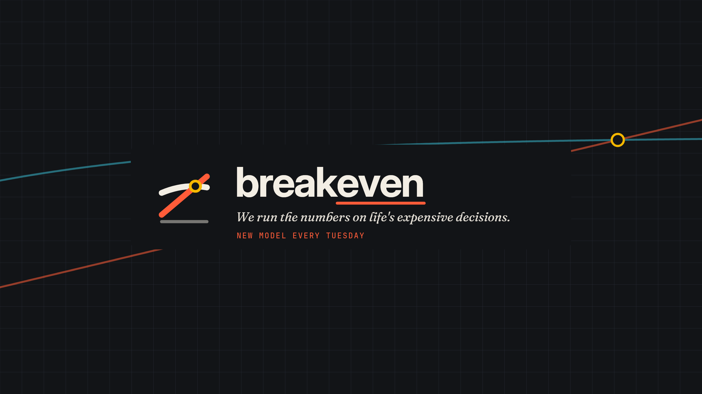

# Breakeven: a data-driven personal-finance media company

> **We run the numbers on life's expensive decisions.**
> Every video takes one big money decision (rent vs buy, pay off the mortgage vs invest, Roth vs traditional…), builds a transparent model from real, cited data, and finds the **breakeven point** where one choice overtakes the other. Visuals are rendered from code, not stock footage. Narration is human-first. Every claim is sourced.



## Why this business (summary of `docs/01-market-research.md`)
- **Highest-value audience on YouTube:** people about to move tens of thousands of dollars. Finance has the highest sponsor CPMs and $50–$400 affiliate payouts.
- **Permanent search demand** that re-ranks every year ("rent vs buy 2027" is a genuinely new video).
- **A real gap:** incumbents are talking heads, dry lectures, or concept animations. Nobody does cinematic, *quantitative* decision storytelling, "the calculator as a documentary".
- **Built for 2026 platform rules:** original models and code-rendered visuals are the strongest defence against the *inauthentic content* policy. Strategy assumes the **8,000-hour YPP bar from Feb 2027**, so affiliate, products and sponsors carry year one.

Winner of a 13-concept weighted scoring (8.65/10; next best 7.15).

## Status of first deliverables
| # | Deliverable | Where | Status |
|---|---|---|---|
| 1 | Market research and niche selection | `docs/01-market-research.md` | ✅ |
| 2 | Competitor analysis | `docs/01-market-research.md` §4 | ✅ |
| 3 | Business strategy | `docs/02-business-strategy.md` | ✅ |
| 4 | Channel branding | `docs/03-brand-guide.md` | ✅ |
| 5 | Logo, banner, avatar, watermark | `brand/assets/` | ✅ rendered from code |
| 6 | 90-day content calendar | `content/calendar-90d.md` | ✅ 13 flagships + 39 Shorts |
| 7 | 20+ video concepts (52, scored) | `content/ideas.csv` | ✅ |
| 8 | Complete script, video #1 | `videos/001-rent-vs-buy/SCRIPT.md` (source: `script.yaml`) | ✅ |
| 9 | Video #1 visual assets | rendered by `breakeven/scenes/` | ✅ |
| 10 | Thumbnail options (3) | `videos/001-rent-vs-buy/output/thumbnails/` | ✅ + mobile preview |
| 11 | **Complete first video** | `videos/001-rent-vs-buy/output/001-rent-vs-buy.mp4` | ✅ 8:04, 1080p30, −14 LUFS, captions, chapters. Draft AI voice pending your narration |
| 12 | Production automation system | `breakeven/` (CLI: `python -m breakeven`) | ✅ tested end to end |
| 13 | Analytics dashboard | `breakeven/dashboard.py` → `dashboard/` (`demo.html` preview) | ✅ (needs your API access for real data) |
| 14 | Financial model | `docs/07-financial-model.md`, `finance/` | ✅ 3 scenarios, 24 months |
| 15 | Launch instructions | `docs/06-launch-guide.md` | ✅ |
| + | Free rent-vs-buy calculator (site) | `site/` | ✅ parity-tested with the video's model |
| + | 3 Shorts cut from video #1 | `videos/001-rent-vs-buy/output/shorts/` | ✅ |

## The production pipeline
```
ideas.csv ─▶ planning (score, calendar) ─▶ model.py (real data → data.json)
   └─ research.discover (YouTube outliers)        │
script.yaml (narration bound to data: {{be|y1}}) ◀┘
   ─▶ tts (human takes in voice/ override Kokoro draft) ─▶ timeline (cues per line)
   ─▶ scenes (skia, 11 shot types, cue-driven animation) ─▶ parallel cached shot renders (ffmpeg/x264)
   ─▶ audio (original procedural score + SFX, ducking, −14 LUFS) ─▶ mux + captions (.srt) + chapters
   ─▶ thumbnails (3 templates + feed preview) ─▶ metadata (description, sources, disclosures)
   ─▶ shorts (9:16 cutdowns) ─▶ QA gate ─▶ human approve (hash-pinned) ─▶ upload (private/scheduled)
   ─▶ analytics pull (YouTube Analytics API → SQLite) ─▶ insights (pattern rules) ─▶ dashboard
```

```bash
python -m pip install -r requirements.txt && python -m breakeven setup
python -m breakeven produce 001-rent-vs-buy     # full rebuild (cached shots → fast)
python -m breakeven qa 001-rent-vs-buy
python -m breakeven dashboard --demo            # preview the dashboard with synthetic data
python -m pytest -q tests
```

### Making the next video
1. `mkdir videos/002-…` with `model.py` (computes `data.json`), `script.yaml`, `sources.yaml`, `thumbnails.yaml`, `metadata.yaml`. Copy 001 as the template.
2. `python -m breakeven produce 002-…`, then review stills with `python -m breakeven still 002-… s09 12.5`.
3. Record narration (`teleprompter`), verify sources, `approve`, publish.

## Repo map
| Path | What |
|---|---|
| `docs/` | Research, strategy, brand, content, compliance, launch guide, financial model |
| `breakeven/` | The pipeline (Python package + CLI) |
| `breakeven/scenes/library.py` | Shot types: chapter, bignumber, statement, stack, splitbar, assumptions, race, lever, heatmap, checklist, endscreen |
| `breakeven/models/` | Analytical models (rent vs buy) |
| `videos/<slug>/` | One folder per video: model, script, sources, packaging, outputs |
| `content/` | Idea backlog, calendar |
| `brand/` | Fonts (OFL) and generated brand assets |
| `site/` | Free calculator website (static) |
| `finance/` | Financial model, cost/revenue ledgers |
| `dashboard/` | Generated dashboards |
| `channel.yaml` | Channel-wide settings (links, disclosures, affiliates) |

## Ground rules baked into the code
- No upload without a human approval file pinned to the exact video hash; uploads are **private** by default.
- QA blocks banned claims ("guaranteed", "risk-free"…), missing sources, bad loudness, missing chapters and broken packaging.
- Synthetic narration automatically sets YouTube's disclosure flag and adds a description note.
- Secrets live in `~/.config/breakeven/`, never in git.
- All assets are owned: code-rendered visuals, procedural music and SFX, OFL fonts, Apache-2.0 TTS weights.
