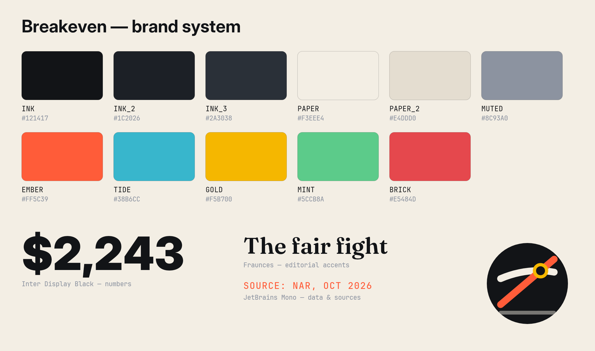

# 03 — Brand Guide: Breakeven

## Name and promise
- **Channel name:** Breakeven
- **Preferred handle:** `@breakeven`. Fallbacks, in order: `@breakevenmoney`, `@breakeven.money`, `@runbreakeven`, `@breakevenlab`
- **Tagline:** *We run the numbers on life's expensive decisions.*
- **Signature moment:** the **breakeven**, where two lines cross, a gold ring drops and the frame names the year.

## The mark
Two paths race over a baseline: the **paper curve** starts ahead and flattens; the **ember line** climbs steadily, overtakes, and the crossing is marked with a **gold ring**. It's a literal picture of every video. The mark is drawn by code (`breakeven/brand.py → draw_mark`), so it animates natively; it "draws itself" on chapter cards.

| Asset | File | Use |
|---|---|---|
| Profile picture | `brand/assets/avatar-800.png` | YouTube avatar (upload at 800×800) |
| Banner | `brand/assets/banner-2560x1440.png` | Channel banner. Text sits inside the 1546×423 all-device safe area |
| Watermark | `brand/assets/watermark-150.png` | YouTube Studio → Customization → Branding → Video watermark |
| Logo, dark | `brand/assets/logo-horizontal-dark.png` | On dark backgrounds |
| Logo, light | `brand/assets/logo-horizontal-light.png` | Website, media kit, sponsor decks |
| Vector mark | `brand/assets/mark.svg`, `mark-light.svg` | Web, favicon |

Regenerate everything with `python -m breakeven brand`.

## Colour: "Ink & Paper"
Videos are **ink** (dark, cinematic, TV-friendly). Thumbnails are **paper** (cream) so they jump out of YouTube's dark UI and away from the red/yellow sea of finance thumbnails.

| Token | Hex | Meaning (never repurpose) |
|---|---|---|
| INK | `#121417` | Video background, thumbnail type |
| INK_2 / INK_3 | `#1C2026` / `#2A3038` | Panels / hairlines on ink |
| PAPER | `#F3EEE4` | Thumbnail background, video type |
| MUTED | `#8C93A0` | Secondary text, axes, sources |
| **EMBER** | `#FF5C39` | **Choice A** (e.g. buying), brand accent |
| **TIDE** | `#38B6CC` | **Choice B** (e.g. renting) |
| **GOLD** | `#F5B700` | **The breakeven moment only**, plus key highlights |
| MINT / BRICK | `#5CCB8A` / `#E5484D` | Gains / losses |

Ember vs Tide (orange vs blue-teal) stays distinguishable for the common colour-vision deficiencies. Charts never rely on red/green alone.

## Typography (all SIL OFL, bundled in `brand/fonts/`)
| Role | Font | Use |
|---|---|---|
| Numbers and headlines | **Inter Display** Black/Bold | Hero numbers, thumbnails, chart values |
| Editorial voice | **Fraunces** SemiBold / Italic | Chapter titles, statements, the "verdict" lines |
| Data and sources | **JetBrains Mono** | Axis labels, sources, chapter tags, kickers (tracked uppercase) |
| Body | **Inter** | Labels and checklists |

## Motion language
- Elements **build on cue**, triggered by the narration line that mentions them, never on a timer.
- Easing: cubic-out for entrances, gentle overshoot (`ease_out_back`) only for hero numbers.
- Cuts between shots; no wipes, spins or glitch transitions.
- One idea per frame. Sources always visible bottom-left in mono.
- The gold ring appears **only** at a true breakeven.

## Sound
Original procedural score (ambient D-minor pad + soft pluck arpeggio) ducked under narration, plus four signature sounds: *whoosh* (chapter), *tick* (value reveal), *pop/thud* (hero number), and *riser → chime* (**the breakeven**). All synthesized in `breakeven/audio.py` and fully owned.

## Voice
- **Calm, precise, slightly wry.** We talk like a smart friend who happens to be an actuary.
- Numbers first, adjectives last. Say "$910 a month more", not "way more expensive".
- **Never prescriptive**: "here's when buying wins", not "you should buy".
- Admit uncertainty out loud ("change one number and this moves a lot").
- Banned: "hack", "secret", "they don't want you to know", "guaranteed", "get rich".

## Target audience
**"The Decider"**: 25–44, US, household income $60–180k, facing a five- or six-figure decision within 12 months; analytical, hype-averse, wants to understand rather than be told. **Secondary: "The Optimizer"**: 30–55, already investing, loves simulations.

## Channel description (paste into YouTube → Customization → Basic info)
> Breakeven runs the numbers on life's most expensive decisions, so you don't have to guess.
>
> Rent or buy? Pay off the mortgage or invest? Roth or traditional? Lease or buy? Every video builds a transparent model from real, cited data and finds the **breakeven point**: the exact year, rate or age where one choice overtakes the other. Then we show you which three or four numbers change the answer for *you*.
>
> 📊 New model every Tuesday
> 🧮 Free calculators for every video (link below)
> 📚 Every number is sourced. Every model is downloadable.
>
> Breakeven is educational content, not individualized financial advice.

## Channel keywords
`rent vs buy, personal finance, breakeven, mortgage calculator, should I buy a house, invest vs pay off mortgage, roth vs traditional, financial independence, money decisions, data visualization`

## Links section
1. Free calculators → `https://<your-site>/` (see launch guide)
2. Newsletter → `https://<your-site>/newsletter`
